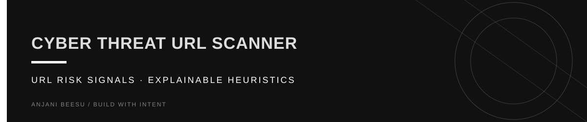

<!-- Visual identity: near-black, warm ivory, and butter yellow. -->

  

<a href="https://github.com/AnjaniBeesu">ANJANI BEESU</a> / <a href="https://www.linkedin.com/in/anjanibeesu/">LINKEDIN</a> / <a href="https://portfolio-theta-olive-54.vercel.app/">PORTFOLIO</a>

---

# Cyber Threat URL Scanner

A Flask-based cybersecurity tool that analyzes URLs and identifies potential phishing indicators.

## Features

* Risk score approximation (0–100)
* HTTPS detection
* Suspicious keyword detection
* Long URL detection
* IP address detection
* Subdomain analysis
* Typosquatting detection
* Dynamic risk meter
* Threat explanation panel

## Technologies

* Python
* Flask
* HTML
* CSS

## Run Locally

pip install flask

python app.py

Then open:
http://127.0.0.1:5000 (Through ur IDE or Browser)

## Future Improvements

* VirusTotal integration
* WHOIS lookup
* Domain age analysis
* Real-time scanning
* Threat database
